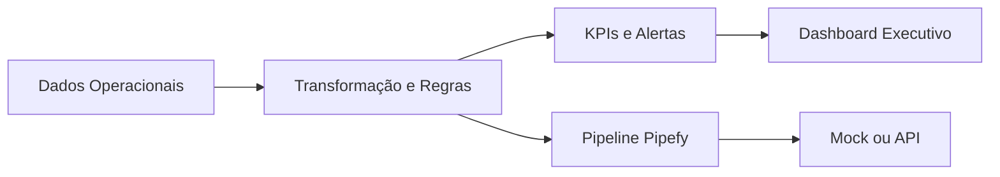

# Central de Automação e Operações

[](https://www.python.org/) [](https://central-automacao-operacoes.streamlit.app/) [](https://www.pipefy.com/) [](https://github.com/samuelmaia-analytics/central-automacao-operacoes/actions/workflows/ci.yml)

> Operações com múltiplos workflows podem perder visibilidade de SLA, backlog, criticidade e gargalos quando as informações ficam dispersas. Para enfrentar esse problema, desenvolvi uma central analítica com Python, SQL e Streamlit, integrada ao Pipefy via API/GraphQL e apoiada por regras automáticas de criticidade e alertas. O resultado é uma visão única para acompanhar prioridades operacionais, identificar atrasos e concentrar atenção nos casos que exigem ação.

## Resultados e capacidades

a operação ganha uma visão consolidada dos workflows e consegue identificar com mais clareza processos vencidos, demandas críticas e itens sem responsável, reduzindo perda de visibilidade e apoiando a priorização antes que desvios de SLA se agravem.

## O que este projeto entrega
- Monitoramento executivo de operação (SLA, risco, backlog e produtividade).
- Camada de inteligência em Python/SQL/Streamlit.
- Integração Pipefy como camada operacional (API real ou modo demonstração).
- Regras automáticas para alertas, criticidade e recomendação de ação.

## Arquitetura (resumo)


## Principais módulos
- `dashboard/app.py`: visão executiva e navegação principal.
- `dashboard/pages/pipefy_workflow_intelligence.py`: inteligência operacional com Pipefy.
- `integrations/pipefy/`: client GraphQL, queries, mapper e pipeline.
- `src/automation/pipefy_rules.py`: motor de regras operacionais.

## Como rodar localmente
```bash
pip install -r requirements.txt
python -m integrations.pipefy.pipefy_pipeline
streamlit run dashboard/app.py
```

## Variáveis de ambiente
```bash
PIPEFY_TOKEN=
PIPEFY_PIPE_ID=
USE_PIPEFY_MOCK=true
APP_DATA_MODE=pipefy
```

Observação: quando `tickets_enriched.csv` não está disponível (ex.: Streamlit Cloud), o app usa automaticamente `data/samples/tickets_enriched_portfolio.csv` como base legada de demonstração.

## Deploy no Streamlit Cloud
Entrada do app: `dashboard/app.py`

Secrets recomendados:
- `APP_DATA_MODE=pipefy`
- `USE_PIPEFY_MOCK=true`
- `PIPEFY_PIPE_ID=<id_do_pipe>`
- `PIPEFY_TOKEN=<opcional>`

## KPIs e capacidades
- Total de cards/processos
- % dentro do SLA
- Backlog aberto e cards vencidos
- Demandas críticas e sem responsável
- Índice de Saúde Operacional
- Alertas automatizados com exportação CSV

## Portfólio e entrevista
Este projeto demonstra capacidade de:
- integrar ferramenta de workflow (Pipefy) com camada analítica;
- transformar dados operacionais em decisões executivas;
- estruturar produto de dados com visão de negócio e automação.

## Documentação técnica
- [Integração Pipefy](docs/pipefy_integration.md)
- [Modelo de Workflow Pipefy](docs/pipefy_workflow_model.md)
- [Regras de Automação Pipefy](docs/automation_rules_pipefy.md)
- [Arquitetura do Projeto](docs/project_architecture.md)

## Licença
Repositório público de portfólio, sob licença **CC BY-NC 4.0**, com atribuição e uso não comercial. Veja [LICENSE](LICENSE).


## Qualidade e governança da publicação

O pipeline principal valida os dados antes de sobrescrever bases, gerar snapshots,
atualizar o DuckDB ou registrar uma execução bem-sucedida. IDs nulos/vazios ou
duplicados, timestamps preenchidos inválidos e resolução anterior à primeira
resposta impedem a publicação. A validação ocorre antes do filtro de watermark,
para que o filtro incremental não esconda inconsistências do candidato.

Tickets sem primeira resposta continuam permitidos e são contabilizados no
resumo de qualidade, pois podem representar demandas aguardando atendimento.
A rastreabilidade utiliza `run_id`, `snapshot_date`, `source_hash` e manifests.

Este é um repositório público de portfólio. Políticas de acesso, retenção e
privacidade documentadas são referências para evolução; não representam IAM
corporativo ou comprovação de conformidade jurídica. As gravações em arquivos
e banco não constituem uma transação única.

### Verificar localmente

```bash
python -m pip install -r requirements.txt
python -m ruff check .
python -m ruff format --check .
python -m pytest -q
```

O GitHub Actions executa lint, formatação e testes em Python 3.11 e 3.12.
Consulte [governança](docs/data_governance.md) e
[privacidade](docs/lgpd_compliance.md) para os limites da implementação.

## Autor

**Samuel de Andrade Maia — Engenheiro de Dados Pleno | Analytics Engineer**

Atuo na **Avanade** desde **20/10/2026**, em Engenharia de Dados. Este é um **projeto pessoal de portfólio**; suas implementações, dados e resultados não representam entregas da Avanade ou de seus clientes.

[LinkedIn](https://www.linkedin.com/in/samuelmaia-analytics/) · [Portfólio](https://samuelmaia-analytics.github.io/samuelmaia-analytics/) · [Currículo em PDF](https://samuelmaia-analytics.github.io/samuelmaia-analytics/assets/Samuel_Maia_Curriculo.pdf)
